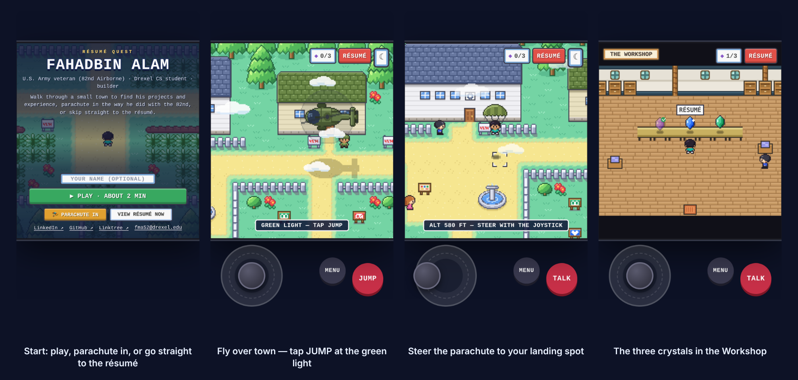

# Résumé Quest

Fahadbin Alam's résumé as a small pixel-art town. Walk around, step into the buildings and read the signs,
or board the helicopter at the airfield and parachute in, the way he did with the 82nd Airborne Division.

The résumé itself is here too: [Fahadbin_Alam_Resume.pdf](Fahadbin_Alam_Resume.pdf). The game's text résumé
matches it word for word, and the **RÉSUMÉ (PDF)** button in the game opens it.

## Play

Open `index.html` in any browser. It is one self-contained file: nothing to install and no server needed.

In a hurry? **VIEW RÉSUMÉ NOW** on the start screen shows the whole résumé as plain text. So do the
**RÉSUMÉ** button and the `R` key at any time, and adding `#resume` to the page address opens it directly.

| | Keyboard | Phone | Controller |
|---|---|---|---|
| Move | Arrow keys or WASD | Joystick | Stick or D-pad |
| Talk / open | Enter or Space | TALK | A |
| Menu | Esc | MENU | B or Start |
| Résumé | R | RÉSUMÉ button | |
| Day / night | N | ☾ button | |

## What's in town

| Place | What it holds |
|---|---|
| The Workshop | Three crystals to collect: Projects, Résumé and Experience |
| Project Park | Four kiosks: Muslimo, Path of the Sahabah, the One World Relief donation platform and Army network automation |
| 82nd Airborne barracks | Army service |
| Airfield | The helicopter flight and parachute jump |
| Drexel University | Education, certifications and skills |
| MSSA Center | Microsoft Software & Systems Academy |
| One World Relief | The nonprofit and its donation platform |
| Book Mart | The book *The Ivory* and the Airbnb host work |
| Fahadbin's house, the bulletin board, the mailbox | Contact details and links |

## How it's made

- One HTML file of about 120 KB with inline CSS and JavaScript. Canvas 2D, no libraries, no image files.
- All of the pixel art (tiles, trees, buildings, characters, the helicopter) is drawn by code when the page loads.
- 16-pixel tiles on a 240×160 view, scaled by whole numbers so the pixels stay crisp. A smoothed look is a switch in the menu.
- Keyboard, touch and gamepad input, with day and night palettes.

The source is in `src/`, split by job. `build.sh` joins the parts in order into `index.html`.

| File | Job |
|---|---|
| `00_head.html` | Page markup and styles |
| `05_data.js` | Résumé content: links, bullet points, skills, the crystals and the kiosks |
| `10_px.js` | Drawing helpers, palettes and the art cache |
| `20_world.js` | Town map, signs, townspeople and interiors |
| `30_tiles.js` | Ground and scenery tiles |
| `40_objs.js` | Trees, buildings, fountain, crystals and airfield art |
| `50_chars.js` | Character sprites |
| `60_content.js` | Panels: crystals, kiosks, buildings and the text résumé |
| `66_jump.js` | Helicopter flight and parachute jump |
| `70_game.js` | State, movement, input, screen fit and rendering |
| `99_tail.html` | Closing tags |

To change the résumé, replace `Fahadbin_Alam_Resume.pdf`, edit `src/05_data.js` and the text résumé in
`src/60_content.js` to match, then run `./build.sh`.

## Test

`node test/smoke.js` plays the main paths in a headless browser (start screen, walking, the résumé, a crystal,
the parachute jump) and fails on any page error. It needs [Playwright](https://playwright.dev):
`npm i -D playwright && npx playwright install chromium`.

## Credits

Designed and directed by Fahadbin Alam. Code and pixel art written with [Claude](https://claude.com).
Fonts: Pixelify Sans and Nunito from Google Fonts.
